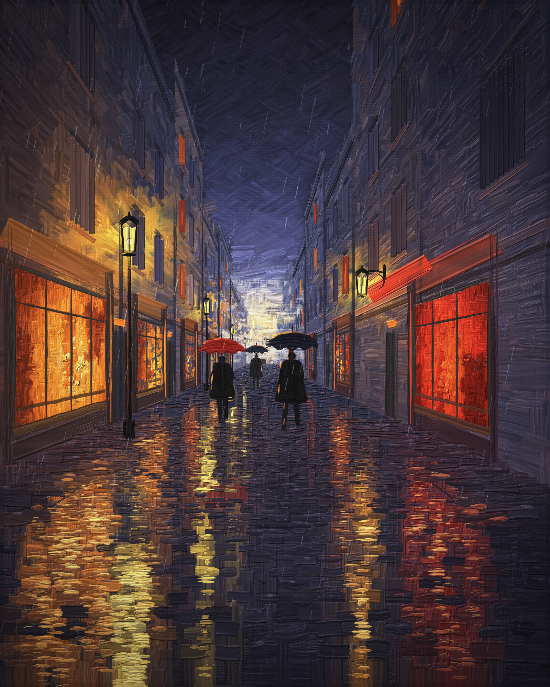
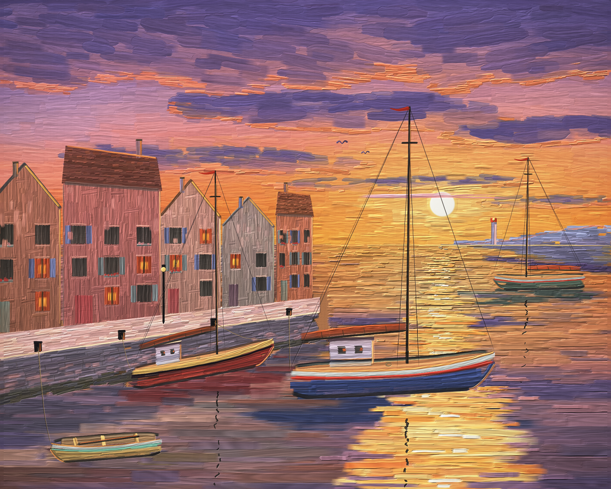
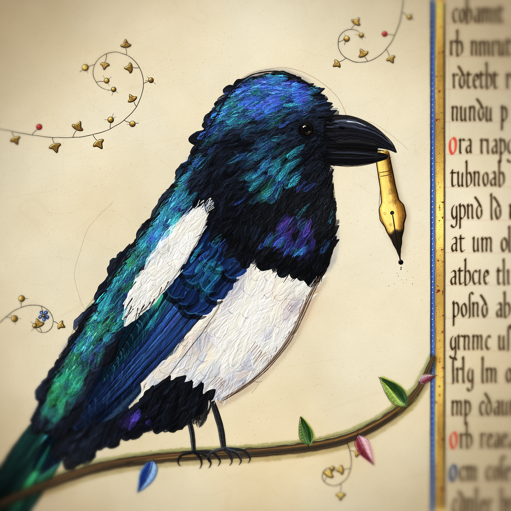
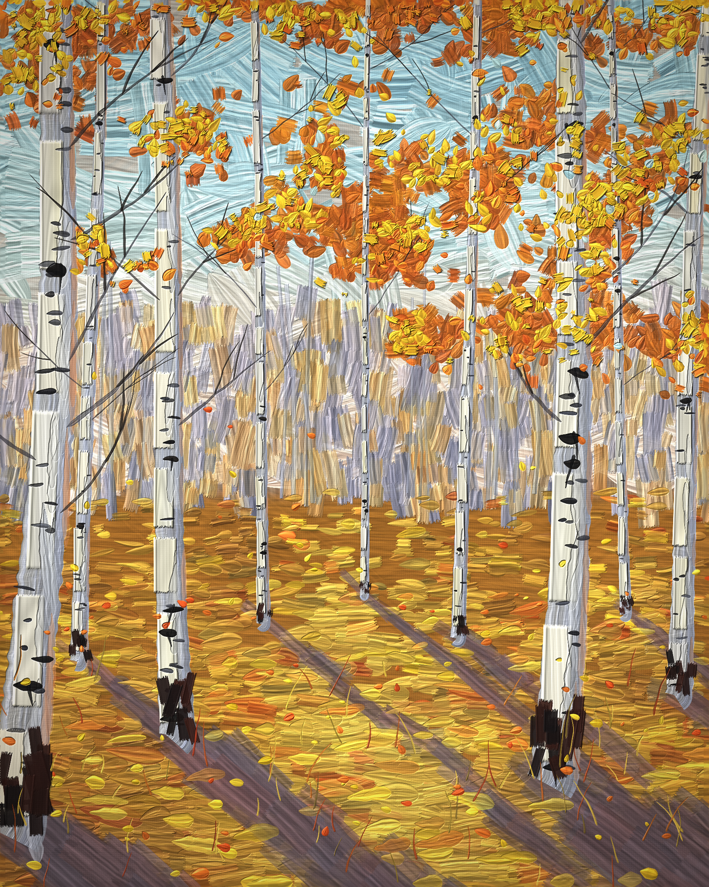
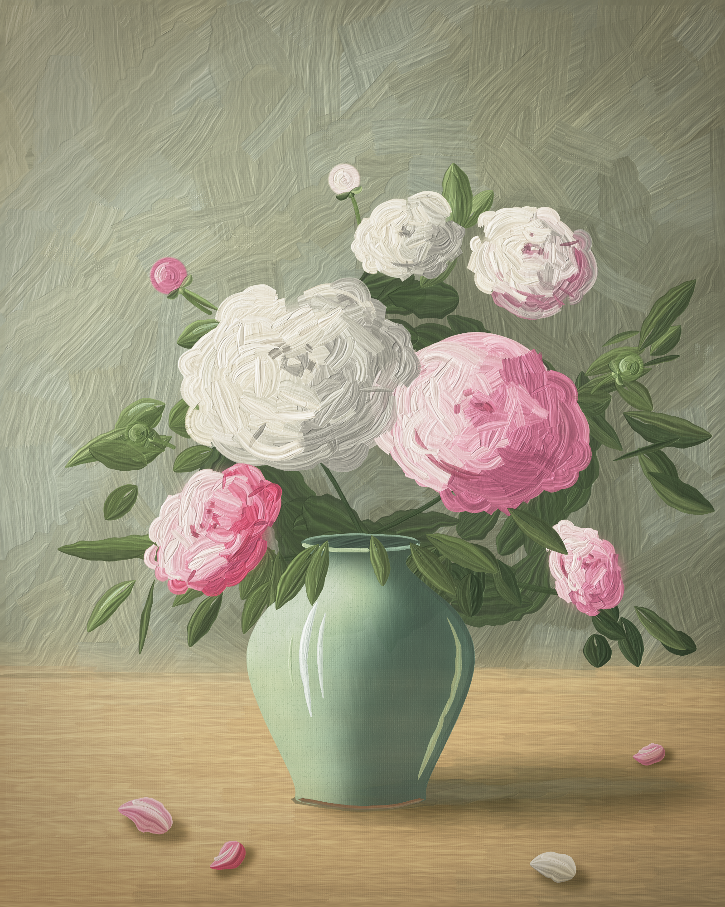

# Can a language model paint?

A set of painting tasks for language models, and the tool that makes them possible: **PaintSim**, a physical paint simulator.

The model gets a prompt ("a fishing harbour at sunset, impasto, palette knife…") and a folder with the simulator. It writes a program that composes the picture stroke by stroke, renders it, looks at the result, and repaints until it is satisfied. Nothing here is made by an image model.

| | |
|---|---|
|  |  |
| *Rainy night street*: 19,998 strokes | *Harbour at sunset*: 9,137 strokes |
|  |  |
| *Magpie in the margin*: about 11,000 marks | *Birches in October*: 8,318 strokes |



*Peonies in a celadon vase*: 1,924 marks

All five were painted by Claude Fable 5.2.

## What is measured

The simulator is a tool. What the tasks measure is whether the model can paint with it:

- **Composition and drawing.** Does it place things well and get their shapes right?
- **Colour and light.** Does it mix a palette, keep its values in order, turn a form from light to shade?
- **Handling.** Does the surface look painted by a hand: varied marks, thick lights, edges that are found and lost?
- **Looking.** Does it see what is wrong with its own picture and fix it?

Two models with the same simulator can make very different pictures. That difference is the result.

## Why a simulator

The first versions of the magpie in this repository were drawn without one: [`magpie-v1.html`](magpie-v1.html), then [`magpie-v2.html`](magpie-v2.html) and [`magpie.html`](magpie.html), each with its own hand-written drawing code. Open them next to [`paintsim/paintings/magpie.png`](paintsim/paintings/magpie.png). The subject and the model are the same; the difference is the paint.

A model that emits SVG or canvas calls has only flat shapes to work with. PaintSim gives it what a painter has:

- A stroke is a bundle of bristles. Each one carries its own colour and load, lays down pigment **and thickness**, breaks on the tooth of the canvas, and runs dry.
- Colours mix as pigments: blue and yellow make green, a little white goes far.
- Wet paint behaves wet: washes bloom, oil picks up and blends what is under it.
- The finished relief is photographed under a lamp, so impasto, gold leaf and gloss catch the light.
- Paints, brushes, grounds and lights are data. So is a whole painting: one JSON document gives the same pixels in the browser and in Node.

This comparison is one subject, seen by eye. It is not a controlled experiment.

## What is here

| | |
|---|---|
| [`paintsim/`](paintsim/) | the simulator: engine, recipes, painting format, player, renderer, tests. Start with its [README](paintsim/README.md) |
| [`paintsim/GUIDE.md`](paintsim/GUIDE.md) | how to get a good picture, and the mistakes everyone makes first |
| [`paintsim/paintings/`](paintsim/paintings/) | finished paintings: the generator (`.gen.mjs`), the document (`.json`) and the render (`.png`) of each |
| [`bench/`](bench/) | the tasks: [`cases.json`](bench/cases.json) (the prompts), [`TASK.md`](bench/TASK.md) (the exact text a model is given), [`make-kit.mjs`](bench/make-kit.mjs) (builds the folder a model works in) |
| `magpie-v1.html`, `magpie-v2.html`, `magpie.html` | the magpie before the simulator existed |

## Run a task

```bash
node bench/make-kit.mjs /tmp/run1 harbour
```

This writes a clean working folder (the simulator, its documents, a starter generator, two finished documents as examples of the format) and prints the task text. Give the model that folder and that text. It needs a shell with Node and a way to look at PNG files. The folder contains nothing about how any task was painted.

The model delivers `paintings/NAME.gen.mjs`, `paintings/NAME.json` and `paintings/NAME.png`. People judge the PNG, whole and close up: is it beautiful, is it the picture that was asked for, does it look painted by hand.

## Look at a painting

```bash
cd paintsim
node tools/render.mjs paintings/rain.json rain.png                               # paint it (Node only, no dependencies)
node tools/render.mjs paintings/rain.json detail.png --scale 3 --crop 250,600,550,900   # a close look
python3 -m http.server 8765   # then open http://localhost:8765/play.html?doc=paintings/rain.json to watch it being painted
```

## Status

- Five tasks. Four have a finished painting here (the fifth, the lemons, is being painted; the magpie is not one of the tasks). Those paintings were made with longer instructions than the task text in `bench/TASK.md`; a run with the short task text is in progress.
- The generators of the finished paintings are in this repository. A model that can read this repository has seen them, so treat these five tasks as examples, not as a held-out test.
- There is no scoring procedure yet beyond people looking at the pictures.

## Licence

MIT. See [LICENSE](LICENSE).
